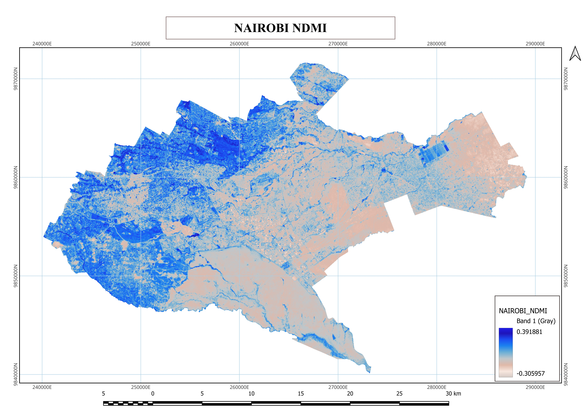

# GIS & Geospatial Projects Portfolio

## Overview

Welcome to my **GIS & Geospatial Projects Portfolio**.

This repository showcases a collection of projects, practical workflows, training materials, and geospatial analyses developed using **Geographic Information Systems (GIS), Remote Sensing, Digital Photogrammetry, and Drone Technologies**.

The projects demonstrate practical applications of geospatial technologies in areas such as:

* Remote sensing data acquisition and processing
* Satellite image visualization and analysis
* Land Use and Land Cover (LULC) mapping
* Spectral indices and environmental analysis
* Digital photogrammetry
* Drone image processing
* Spatial analysis and mapping
* High-resolution imagery analysis
* Geospatial training and capacity development

The repository primarily features workflows developed using **ArcGIS, ArcGIS Pro, QGIS**, and other geospatial technologies.

---

# 🗂️ Repository Contents

## 1. Remote Sensing Data Acquisition Using Landsat

This project introduces the process of acquiring satellite imagery from the **Landsat programme** for geospatial and remote sensing analysis.

Key areas covered include:

* Identification of suitable satellite imagery
* Selection of appropriate acquisition dates
* Consideration of cloud cover
* Downloading and organizing satellite data
* Preparation of imagery for further processing

📄 **Resource:** `1. Data Acquisition_LandSat.pdf`

---

## 2. Adding and Visualizing Remote Sensing Data in QGIS

This project demonstrates how satellite imagery can be added, visualized, and interpreted within **QGIS**.

Topics include:

* Loading raster datasets
* Understanding spectral bands
* Creating colour composites
* True colour visualization
* False colour visualization
* Improving image display for interpretation

📄 **Resource:** `2. Adding and Visualizing Remote Sensing Data in QGIS_Composites.pdf`

Example output:


---

## 3. Image Mosaicking and Clipping

Satellite imagery often consists of multiple scenes or tiles. This workflow demonstrates how multiple raster datasets can be combined and prepared for analysis.

Key processes include:

1. Preparing input imagery
2. Mosaicking multiple raster scenes
3. Defining the Area of Interest (AOI)
4. Clipping the mosaic to the study area
5. Preparing the final dataset for analysis

📄 **Resource:** `3. Mosaic + Clipping to the AOI.pdf`

---

## 4. Spectral Indices

This project demonstrates the use of **spectral indices** to extract environmental information from multispectral imagery.

Examples of indices that can be derived include:

* **NDVI** – Normalized Difference Vegetation Index
* **NDWI** – Normalized Difference Water Index
* **NDBI** – Normalized Difference Built-up Index
* **NDMI** – Normalized Difference Moisture Index

These indices can support applications such as:

* Vegetation monitoring
* Water resource analysis
* Urban and built-up area mapping
* Moisture analysis
* Environmental monitoring

📄 **Resource:** `4. Spectral Indices.pdf`

Example output:



---

## 5. Land Use and Land Cover Mapping

This section demonstrates the application of GIS and remote sensing techniques in **Land Use and Land Cover (LULC) analysis**.

The workflow may involve:

* Data preparation
* Image interpretation
* Classification
* Land cover analysis
* Map production
* Interpretation of spatial patterns

Example output:


---

## 6. Coffee Probability Mapping Using Very High Resolution Imagery

This project explores the use of **Very High Resolution (VHR) imagery and QGIS** for mapping the probability or distribution of coffee-growing areas.

The project demonstrates how geospatial technologies can support:

* Agricultural monitoring
* Crop mapping
* Spatial probability analysis
* High-resolution image interpretation
* Decision-making in agriculture

📄 **Resource:** `A_JRC_Coffee Probability Mapping using VHR and QGIS .pdf`

---

## 7. Digital Photogrammetry and Drone Image Processing

This section focuses on the application of **digital photogrammetry and Unmanned Aerial Vehicles (UAVs)** in geospatial data acquisition and mapping.

Key areas include:

* Drone mission planning
* Image acquisition
* Image alignment
* Camera calibration
* Ground control
* Orthomosaic generation
* Digital Surface Models (DSM)
* Digital Terrain Models (DTM)
* Point cloud generation
* Accuracy assessment

📄 **Resources:**

* `Digital Photogrammetry and Drone Image Processing Manual_2026 (1).pdf`
* `Drone Image Procesing_manual in ArcGIS Pro.pdf`

---

# 🔄 General Geospatial Workflow

The projects in this repository generally follow a structured geospatial analysis workflow:

```text
Data Acquisition
       │
       ▼
Data Preparation
       │
       ▼
Data Processing
       │
       ▼
Spatial / Remote Sensing Analysis
       │
       ▼
Validation and Interpretation
       │
       ▼
Map Production and Visualization
       │
       ▼
Decision Support
```

A detailed overview of the workflow is available in:

📄 `The Processes Overview.pdf`

---

# 🛠️ Tools and Technologies

The projects and learning materials in this repository involve the use of:

* ArcGIS
* ArcGIS Pro
* QGIS
* Remote Sensing
* Landsat Satellite Data
* Digital Photogrammetry
* Drone/UAV Imagery
* Raster Analysis
* Spatial Analysis
* Geographic Information Systems

---

# 🎯 Purpose of This Repository

This repository serves as a portfolio of my work and experience in **GIS, Remote Sensing, Cartography, Photogrammetry, and Geospatial Analysis**.

It is intended to demonstrate:

* Practical GIS workflows
* Remote sensing analysis skills
* Spatial data processing
* Geospatial problem-solving
* Digital mapping and visualization
* Drone and photogrammetric workflows
* Development of geospatial training and instructional materials

It also provides learning resources that may be useful to students, GIS professionals, researchers, and anyone interested in geospatial technologies.

---

# 📌 Featured Skills

**GIS & Spatial Analysis**
ArcGIS • ArcGIS Pro • QGIS • Spatial Analysis • Cartography

**Remote Sensing**
Landsat • Multispectral Imagery • Image Processing • Spectral Indices • LULC Mapping

**Photogrammetry & UAV Mapping**
Drone Image Processing • Orthomosaics • DSM/DTM • Point Clouds • Digital Photogrammetry

**Geospatial Training**
Curriculum Development • Technical Training • Practical Exercises • Learning Materials • Assessment Design

---

# 👤 Author

**Kipkirui Ngenoh**

Geospatial Professional | GIS | Remote Sensing | Photogrammetry | Cartography

This portfolio represents selected projects, workflows, and learning resources developed as part of my professional and technical work in the geospatial field.

---

## 📫 Connect

For professional collaboration, GIS projects, geospatial training, or other opportunities, feel free to connect with me through my professional profile or GitHub account.

**GitHub:** [Kipshazngeno](https://github.com/Kipshazngeno)

---

### ⭐ If you find these resources useful

Feel free to explore the projects, use the learning materials for educational purposes where appropriate, and star the repository.

